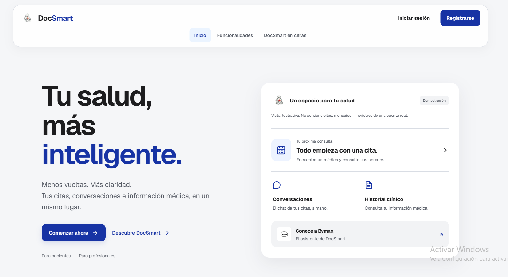
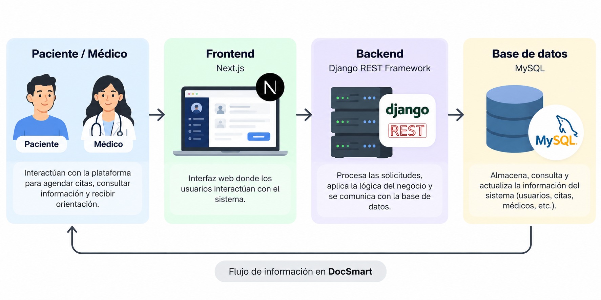

# 🏥 DocSmart

> Plataforma web para la gestión integral de citas médicas, historial clínico digital y teleorientación asistida por Inteligencia Artificial (Bymax).



[](https://nextjs.org/)
[](https://www.djangoproject.com/)
[](https://channels.readthedocs.io/)
[](https://docsmart.site/)

---

## 📌 El Problema
El acceso a servicios de salud ambulatorios suele presentar demoras en la asignación de citas, dispersión de historiales clínicos y falta de canales de orientación médica oportunos. Tanto pacientes como profesionales independientes requieren un ecosistema centralizado para organizar la atención de forma ágil y segura.

## ✅ La Solución
**DocSmart** centraliza la experiencia médica en una plataforma web moderna que integra:
- **Agendamiento Inteligente:** Búsqueda por especialidad y ciudad, validación de disponibilidad y reprogramación de citas.
- **Historial Clínico Seguro:** Registro de diagnósticos, trazabilidad de atenciones y gestión documental.
- **Asistente Clínico Bymax:** Chatbot con soporte de voz e IA para orientación inicial de pacientes, registro de estado de ánimo y apoyo en el triaje.
- **Comunicación en Tiempo Real:** Salas de chat por cita y notificaciones instantáneas mediante WebSockets.

---

## 📚 Documentación del Proyecto

Para conocer el detalle técnico y metodológico, consulta los módulos en [`/docs`](docs/):

| Sección | Documento | Descripción |
|---|---|---|
| **Análisis** | [Requerimientos](docs/Analisis/requerimientos.md) | Alcance, requerimientos funcionales y no funcionales |
| **Análisis** | [Casos de Uso](docs/Analisis/casos-de-uso.md) | Identificación de actores, diagrama UML y especificaciones (CU-01 al CU-10) |
| **Análisis** | [Visión de Producto](docs/Analisis/product.md) | Alcance, lineamientos funcionales y reglas de negocio |
| **Diseño** | [Sistema de Diseño](docs/Diseno/sistema-de-diseno.md) | Tokens UI, tipografía Geist, paleta de colores y componentes reutilizables |
| **Asistente Bymax** | [Flujo Conversacional](docs/Asistente-Bymax/flujo-conversacional.md) | Gestión de contexto clínico, memoria, prompts y ejecución de herramientas (tools) |
| **Asistente Bymax** | [Integración de Voz](docs/Asistente-Bymax/integracion-de-voz.md) | Captura por micrófono (Web Audio API) y síntesis de voz con ElevenLabs (TTS) |
| **Implementación** | [Arquitectura](docs/Implementacion/arquitectura.md) | Arquitectura desacoplada, WebSockets (Daphne/Channels) y flujo de datos |
| **Implementación** | [API & Endpoints](docs/Implementacion/endpoints.md) | Catálogo completo de rutas REST y eventos en tiempo real |
| **Implementación** | [Base de Datos](docs/Implementacion/base-de-datos.md) | Modelo relacional, tablas maestras y diccionario de datos |
| **Implementación** | [Registro de Médicos](docs/Implementacion/registro-medico.md) | Flujo de registro profesional, carga de soportes y validación administrativa |
| **Implementación** | [Despliegue](docs/Implementacion/despliegue.md) | Guía de instalación paso a paso, configuración de entorno (.env) y ejecución |
| **Evidencias** | [Pruebas](docs/Evidencias/pruebas-unitarias.md) | Cobertura de pruebas automatizadas en backend/frontend y validaciones |

---

## 🛠️ Tecnologías

| Capa | Tecnologías |
|---|---|
| **Frontend** | Next.js, React, CSS Modules, Tailwind CSS, Web Audio API |
| **Backend** | Python, Django, Django REST Framework, Django Channels (ASGI / Daphne) |
| **Inteligencia Artificial** | OpenAI API, ElevenLabs API |
| **Base de Datos** | MySQL / PostgreSQL |
| **DevOps & Herramientas** | Git, GitHub, Docker |

---

## 🏗️ Arquitectura y Flujo



---

## 🚀 Cómo Ejecutarlo

### 1. Clonar el repositorio
```bash
git clone [https://github.com/tu-usuario/DocSmart.git](https://github.com/tu-usuario/DocSmart.git)
cd DocSmart

cd backend
python -m venv venv

# Windows:
venv\Scripts\activate
# Linux/macOS:
source venv/bin/activate

pip install -r requirements.txt

# Configurar variables de entorno copiando el archivo de ejemplo
cp .env.example .env

python manage.py migrate
daphne -b 0.0.0.0 -p 8000 core.asgi:application


cd ../frontend
npm install

# Iniciar en modo desarrollo
npm run dev
```