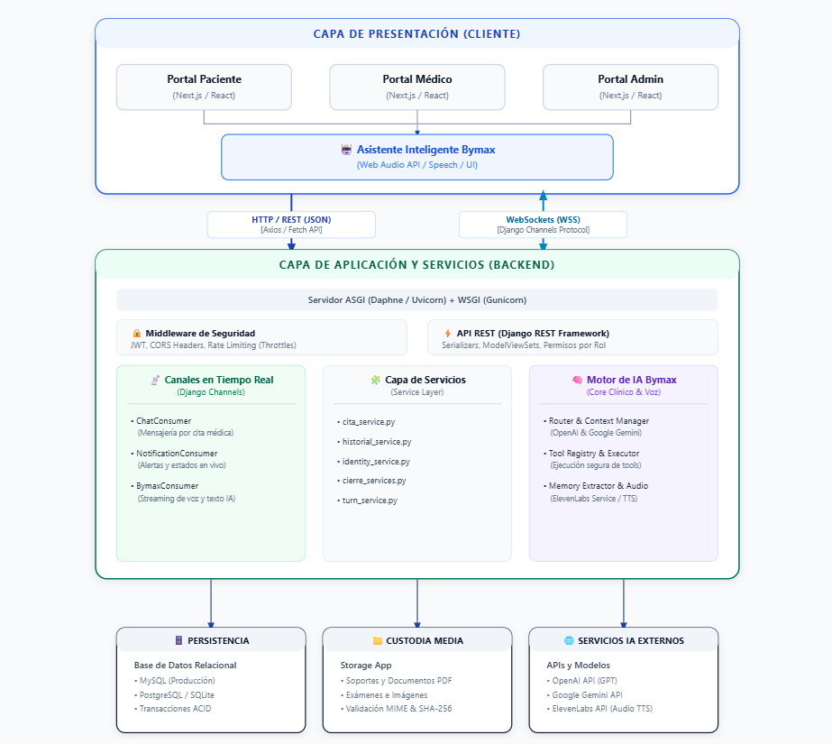
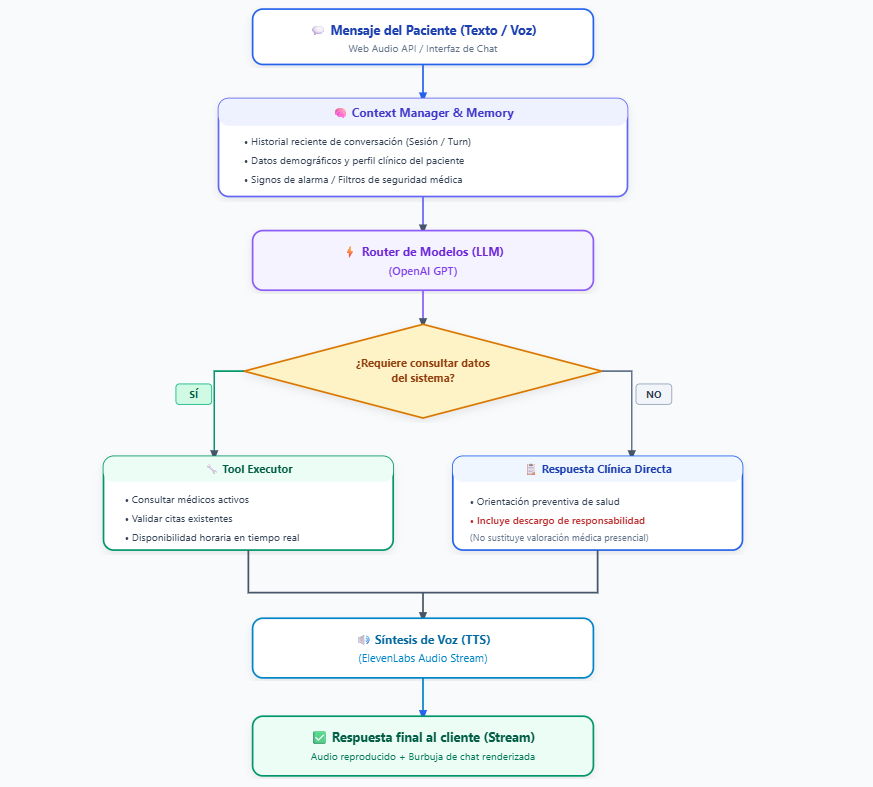

- [Regresar - Página Principal](../../README.md)

# 🏗️ Arquitectura de Software — DocSmart

> **Proyecto:** DocSmart — Plataforma de Gestión Médica y Asistente Clínico Inteligente  
> **Área:** Implementación e Ingeniería de Software  
> **Estándar:** Arquitectura Cliente-Servidor Desacoplada, Patrón MVT/Service Layer y Arquitectura Dirigida por Eventos (EDA)  

---

## 📌 1. Visión General de la Arquitectura

**DocSmart** implementa una arquitectura desacoplada basada en la separación estricta de responsabilidades entre el **Frontend** (interfaz de usuario reactiva y renderizado moderno) y el **Backend** (lógica de negocio, persistencia, seguridad, canales en tiempo real y servicios de IA).

La plataforma combina dos modelos de comunicación:
1. **Peticiones Síncronas (HTTP / REST):** Operaciones CRUD estándar, autenticación, parametrización de horarios, carga de historias clínicas y dashboards.
2. **Comunicación Asíncrona Bidireccional (WebSockets / ASGI):** Salas de chat privadas por cita médica, notificaciones instantáneas y eventos del asistente clínico en tiempo real.

---

## 🏛️ 2. Diagrama Arquitectónico del Sistema



---

## 🧩 3. Desglose de Capas del Sistema

### 3.1. Capa de Presentación (Frontend)
Construida con **Next.js** y **React**, aprovecha la optimización de rutas del cliente y componentes modulares:
- **Enrutamiento y Estructura:** Separación lógica por módulos funcionales (`admin/`, `doctor/`, `patient/`, `bymax/`, `chat/`).
- **Gestión de Estado y Reactividad:** Hooks personalizados (`useDashboard`, `useAvailability`, `useChatConversation`, `useBymaxVoice`) para desacoplar el estado de la UI de la lógica de red.
- **Audio y Voz:** Integración nativa con la **Web Audio API** para captura de audio por micrófono y reproducción de voz sintetizada del asistente.
- **Estilos y Temas:** CSS Modules y Tailwind CSS bajo la especificación del sistema de diseño (tokens semánticos de color, tipografía Geist y soporte accesible para temas claro/oscuro).

### 3.2. Capa de API y Negocio (Backend)
Desarrollada sobre **Python**, **Django** y **Django REST Framework (DRF)**:
- **Arquitectura de Apps Modulares:**
  - `core/`: Punto de entrada ASGI/WSGI, configuración global, CORS y paginación genérica.
  - `users/`: Manejo de usuarios, roles, recuperación de contraseña y validación documental.
  - `medicos/`: Registro profesional, control de agenda semanal y excepciones de horarios.
  - `citas/`: Flujo y ciclo de vida de citas, validación de reglas temporales (cancelación de 24h) y cierre de atenciones.
  - `historial_medico/`: Registro inmutable de antecedentes y evoluciones clínicas.
  - `chat_citas/`: Canales de comunicación síncrona/asíncrona vinculados a citas médicas.
  - `notificaciones/`: Mensajería reactiva a eventos del sistema.
  - `chatbot/`: Núcleo de inteligencia artificial de Bymax.
  - `storage_app/`: Custodia segura y validación estricta de archivos multimedia.
- **Service Layer (Capa de Servicios):** Se separa la lógica de negocio de las vistas (`views.py`). Los archivos `services.py` centralizan las transacciones complejas, garantizando que los controladores se limiten a validar y responder.

---

## ⚡ 4. Mecanismo de Comunicación en Tiempo Real (WebSockets)

Para evitar el consumo excesivo de recursos por sondeo periódico (*polling*), el sistema utiliza el protocolo **ASGI** gestionado por **Daphne** y **Django Channels**:

```text
[Cliente Next.js]                                            [Backend Django Channels]
        │                                                               │
        │─── 1. Petición HTTP Upgrade (ws:// o wss://) ────────────────>│
        │<── 2. Conexión aceptada (Handshake exitoso) ──────────────────│
        │                                                               │
        │─── 3. Enviar mensaje de chat (JSON con id_cita y contenido) ─>│
        │                                                               ├── Guarda mensaje en BD
        │                                                               ├── Enruta por Channel Layer
        │<── 4. Broadcast instantáneo a participantes de la cita ───────│
```

---

## 🤖 5. Arquitectura del Asistente Clínico Bymax

Bymax opera como un subsistema de inteligencia artificial orquestado desde el backend:



---

## 🔒 6. Seguridad y Protección de Datos

1. **Gestión de Credenciales Sensibles:**
   - Cero secretos en el código fuente: llaves de bases de datos, claves de API (`OPENAI_API_KEY`, `ELEVENLABS_API_KEY`) y `SECRET_KEY` de Django residen exclusivamente en variables de entorno (`.env`).
2. **Cifrado en Tránsito y Reposo:**
   - Cifrado en tránsito forzado bajo protocolos seguros HTTPS/WSS (TLS 1.3).
   - Contraseñas almacenadas exclusivamente mediante algoritmos seguros de derivación de claves (`PBKDF2` / `Argon2`).
3. **Inmutabilidad de la Historia Clínica:**
   - La arquitectura aplica un patrón *Append-Only* en las historias clínicas. Las consultas y adiciones se ejecutan bajo transacciones atómicas; el sistema bloquea operaciones destructivas (`UPDATE`, `DELETE`) sobre registros consolidados.
4. **Validación de Archivos (Anti-Malware):**
   - El módulo `storage_app` inspecciona el tipo MIME real del binario, no solo la extensión del archivo, y restringe el tamaño de carga a un máximo de 10 MB.

---

## 🛠️ 7. Decisiones Técnicas y Justificación (ADRs)

| Decisión | Alternativa Evaluada | Justificación |
| :--- | :--- | :--- |
| **Separación Frontend/Backend** | Aplicación monolítica Django con plantillas HTML | Permite una interfaz moderna y fluida con Next.js, escalabilidad independiente y consumo de la misma API por posibles clientes móviles futuros. |
| **Django Channels + Daphne** | Sondeo periódico HTTP (*Polling*) | Menor consumo de ancho de banda, latencia inferior a 250 ms y mejor experiencia en chats y notificaciones en vivo. |
| **Arquitectura de Servicios** | Toda la lógica en los controladores/vistas (`views.py`) | Evita vistas sobrecargadas (*Fat Views*), facilita la reutilización de lógica entre REST y WebSockets y simplifica las pruebas unitarias. |
| **Next.js con React** | Single Page Application pura (Vite / CRA) | Enrutamiento optimizado, arquitectura modular basada en componentes y mejor rendimiento de carga inicial. |