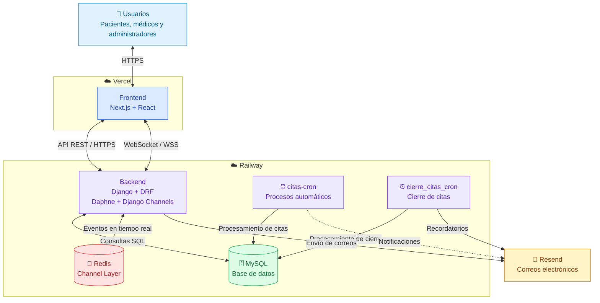

- [Regresar - Página Princiapl](../../README.md)

Despliegue de DocSmart

## 1. Descripción general

DocSmart se despliega con una arquitectura separada: el frontend desarrollado en Next.js se publica en Vercel, mientras que el backend construido con Django y Django REST Framework se ejecuta en Railway. Los datos se almacenan en MySQL.

El backend también gestiona la comunicación en tiempo real mediante Django Channels y WebSockets, el envío de correos electrónicos a través de Resend y los procesos automáticos de citas mediante un servicio programado en Railway llamado citas-cron y cierre-citas-cron.

## 2. Arquitectura del despliegue



El frontend se comunica con la API REST del backend por HTTPS. Para la recepción de notificaciones y otros eventos en tiempo real, establece conexiones WebSocket seguras (wss://). El backend procesa las solicitudes, consulta la base de datos y utiliza Resend para el envío de correos automáticos.

## 3. Requisitos para el despliegue

Repositorio de DocSmart alojado en GitHub.

Cuenta y proyecto configurado en Railway.

Cuenta y proyecto configurado en Vercel.

Base de datos MySQL accesible desde el backend.

Credenciales de Resend y un remitente autorizado.

Variables de entorno necesarias para Django, Next.js y los servicios integrados.

## 4. Configuración del backend en Railway

El backend se encuentra en el directorio backend/ del repositorio.

Crear el proyecto en Railway y vincular el repositorio de GitHub.

Crear el servicio correspondiente al backend y establecer backend como directorio raíz, si Railway utiliza la estructura completa del repositorio.

Configurar las variables de entorno de Django, MySQL y los servicios externos.

Configurar el comando de inicio del servidor ASGI utilizado por el proyecto.

Ejecutar las migraciones pendientes en la base de datos configurada.

Desplegar el servicio y comprobar su funcionamiento en los registros de Railway.

Migraciones de Django:

python manage.py migrate

Servidor ASGI: DocSmart utiliza Django Channels para WebSockets, por lo que el servicio de producción debe ejecutar la aplicación ASGI. Un ejemplo de comando con Daphne es:

daphne -b 0.0.0.0 -p "$PORT" <modulo_del_proyecto>.asgi:application

<modulo_del_proyecto> representa el módulo ASGI definido en el backend. Se debe utilizar el nombre configurado en el proyecto, no el texto del ejemplo.

Variables de entorno del backend

Configuración

Finalidad

Clave secreta de Django

Configuración de seguridad del backend.

Modo de producción y dominios permitidos

Configuración de Django para acceder desde los dominios publicados.

Credenciales de MySQL

Conexión a la base de datos.

FRONTEND_URL

Dirección pública del frontend, utilizada para construir enlaces en los correos.

RESEND_API_KEY

Autenticación con Resend.

RESEND_FROM_EMAIL

Dirección remitente de los correos.

Configuración de orígenes CORS y CSRF

Permitir las solicitudes autorizadas procedentes del frontend.

Los nombres concretos de las variables de Django y MySQL deben coincidir con los que lee la configuración del backend. Las claves y contraseñas se registran en Railway y no en los archivos del repositorio.

## 5. Base de datos MySQL

El backend utiliza MySQL para almacenar la información de usuarios, médicos, citas, historiales y otros datos de la aplicación.

Para conectar la base de datos en producción:

Disponer de una instancia MySQL accesible desde el servicio de Railway.

Configurar en Railway los datos de conexión que utiliza Django: servidor, puerto, base de datos, usuario y contraseña.

Comprobar que el servicio backend pueda conectarse a MySQL.

Aplicar las migraciones con python manage.py migrate.

Las migraciones crean o actualizan las tablas de acuerdo con los modelos y archivos de migración incluidos en el proyecto.

## 6. Configuración del frontend en Vercel

El frontend está desarrollado con Next.js y se encuentra en frontend/.

Importar el repositorio de GitHub en Vercel.

Seleccionar Next.js como framework y configurar frontend como directorio raíz.

Configurar las variables de entorno públicas que utiliza el frontend para comunicarse con el backend.

Iniciar el despliegue y esperar a que finalice la compilación.

Comprobar que el sitio publicado pueda consultar la API y abrir las páginas de la aplicación.

La URL de producción del backend se configura en las variables que utiliza el cliente HTTP del frontend. Para el asistente Bymax, el proyecto ha utilizado la variable NEXT_PUBLIC_BYMAX_WS_URL para la conexión WebSocket.

Ejemplo de dirección de WebSocket en producción:

NEXT_PUBLIC_BYMAX_WS_URL=wss://api.docsmart.site

Las variables con prefijo NEXT_PUBLIC_ son visibles desde el navegador, por lo que no deben contener claves privadas.

## 7. WebSockets en producción

DocSmart utiliza **Django Channels, Daphne y Redis** para permitir la comunicación en tiempo real entre el frontend y el backend, principalmente en las notificaciones, el asistente virtual Bymax y chat entre paciente y doctor.

El frontend, alojado en Vercel, establece conexiones WebSocket seguras (`WSS`) con el backend desplegado en Railway. **Daphne** recibe las conexiones, **Django Channels** las gestiona y **Redis** funciona como capa de canales (*channel layer*) para distribuir los eventos en tiempo real.

### 7.1. Configuración en producción

En el frontend se configura la siguiente variable de entorno:

```env
NEXT_PUBLIC_BYMAX_WS_URL=wss://api.docsmart.site
```

En el backend se configura la conexión con Redis mediante variables de entorno privadas.

### 7.2. Verificación

Para comprobar su funcionamiento, se abre la aplicación y, desde las herramientas de desarrollador del navegador, se accede a **Network → WS** para verificar que la conexión WebSocket esté activa y que los mensajes se transmitan correctamente.


8. Correos automáticos con Resend

DocSmart utiliza Resend para enviar mensajes relacionados con el registro de médicos, la recuperación de contraseñas y los eventos de las citas médicas.

Las variables necesarias para esta integración son:

RESEND_API_KEY=<clave_de_resend>
RESEND_FROM_EMAIL=<correo_remitente_autorizado>
FRONTEND_URL=<url_del_frontend_en_vercel>

Los correos de citas reutilizan una plantilla HTML y un servicio de envío ubicados en:

backend/notificaciones/templates/emails/cita_notificacion.html
backend/notificaciones/email_citas_services.py

Los eventos contemplados incluyen solicitud, confirmación, reprogramación, cancelación, vencimiento y finalización de citas. Resend devuelve un identificador cuando acepta el envío; la entrega al destinatario se verifica desde el panel del servicio.

## 9. Procesos automáticos con `citas-cron` y `cierre_citas_cron`

DocSmart utiliza **dos servicios independientes en Railway** para ejecutar tareas automáticas relacionadas con la gestión de citas médicas. Ambos utilizan comandos de Django y se conectan a la base de datos MySQL.

### 9.1. Servicio `citas-cron`

Este servicio se encarga de **procesar automáticamente las citas que superan su plazo de confirmación**.

Cuando una cita permanece sin confirmar después del tiempo establecido, el sistema actualiza su estado a vencida y genera las notificaciones correspondientes.

**Comando de ejecución:**

```bash
python manage.py procesar_citas_vencidas
```

### 9.2. Servicio `cierre_citas_cron`

Este servicio gestiona los **recordatorios y vencimientos del plazo de cierre de las citas médicas**.

El sistema realiza las siguientes acciones:

| Tiempo transcurrido | Acción                                                 |
| ------------------- | ------------------------------------------------------ |
| **24 horas**        | Envía un primer recordatorio al médico.                |
| **48 horas**        | Envía un segundo recordatorio al médico.               |
| **72 horas**        | Procesa el vencimiento del plazo de cierre de la cita. |

**Comando de ejecución:**

```bash
python manage.py procesar_cierre_citas
```

### 9.3. Configuración en Railway

Ambos servicios se encuentran desplegados de forma independiente del backend principal.

Cada servicio tiene configurado su respectivo comando de Django y las variables de entorno necesarias para conectarse a **MySQL** y utilizar **Resend** cuando se requiere enviar notificaciones por correo electrónico.

La ejecución se realiza automáticamente mediante las tareas programadas de Railway, sin intervención manual de los usuarios.


## 10. Verificación del despliegue

Una vez publicados los servicios, se comprueba que:

El frontend de Vercel abra correctamente las páginas de DocSmart.

El backend de Railway responda las solicitudes de la API.

Django esté conectado a MySQL y tenga las migraciones aplicadas.

Los WebSockets establezcan conexiones seguras y reciban eventos.

Los correos automáticos sean aceptados por Resend y puedan verificarse desde su panel.

citas-cron y cierre-citas-cron ejecuten los comandos previstos y registren sus resultados en Railway.

Estas comprobaciones permiten verificar la comunicación entre los servicios que forman el despliegue de DocSmart.